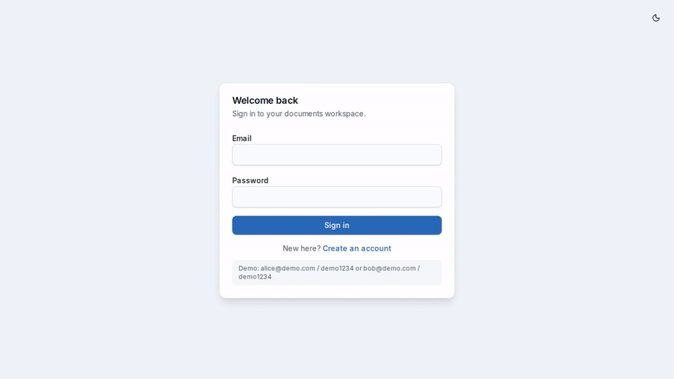
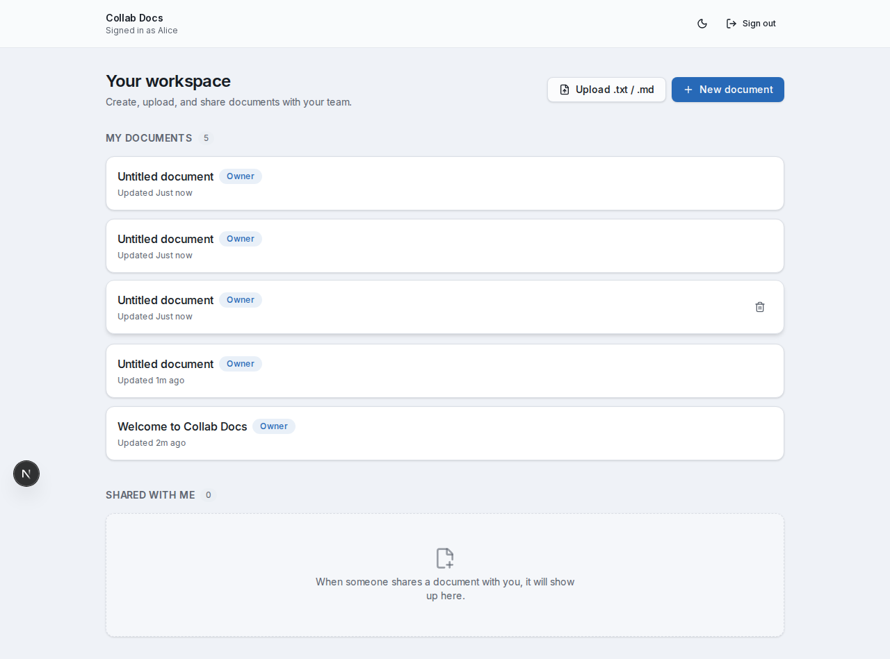
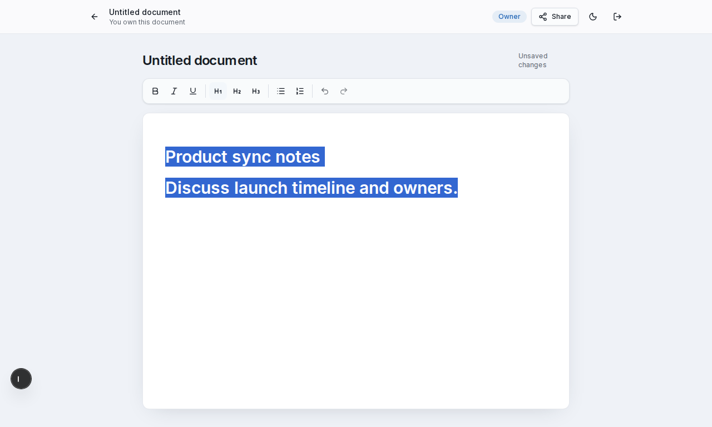
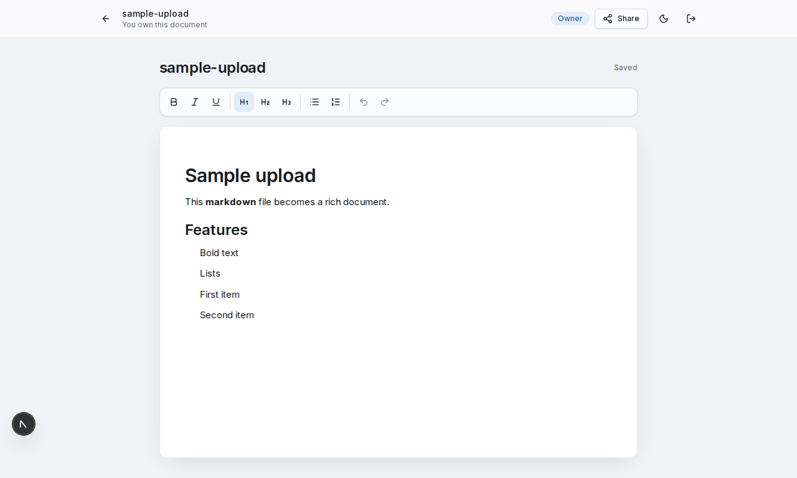
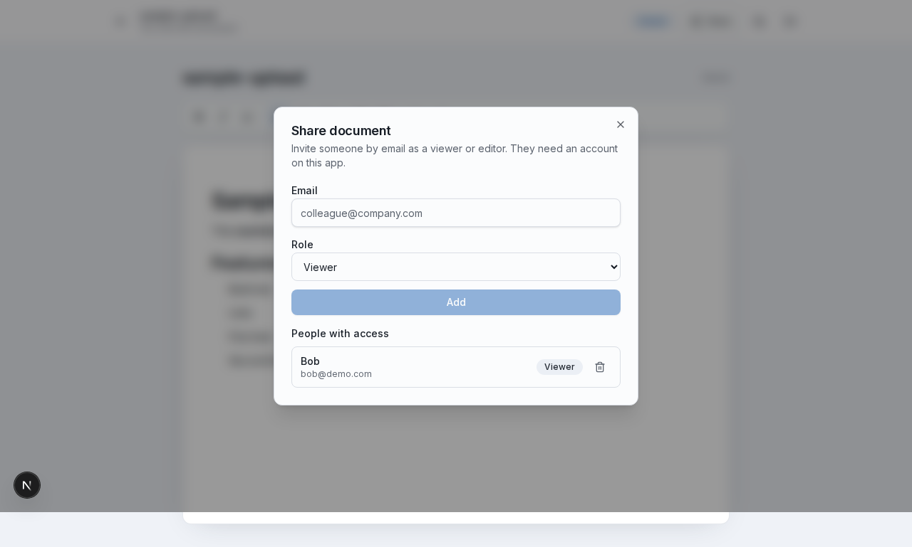
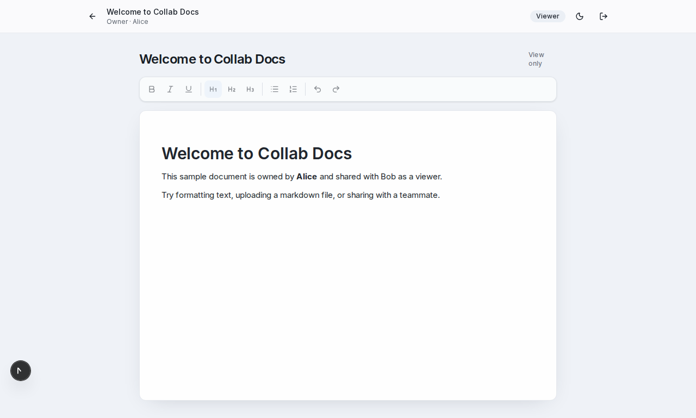

# Collab Docs

A lightweight, Google Docs–style collaborative document editor built as a take-home project. Create rich documents, upload Markdown, share by email with viewer/editor roles, and autosave to Postgres.



## Live demo

**URL:** _TBD — add your Vercel deployment URL after deploy_

## Demo accounts

| Email | Password | Notes |
| --- | --- | --- |
| `alice@demo.com` | `demo1234` | Owns the seeded sample doc |
| `bob@demo.com` | `demo1234` | Has viewer access to Alice’s sample doc |

## Features

- Dashboard with **My documents** and **Shared with me** (owner / role badges)
- TipTap rich text: bold, italic, underline, H1–H3, lists, undo/redo, sticky toolbar
- Upload `.txt` / `.md` (≤ 1MB) into a new editable document
- Share by email as viewer or editor; owner can revoke
- Server-enforced permissions (read / edit / share / delete)
- Debounced autosave (~1s) with Saving / Saved / Error + retry
- Dark mode, responsive layout

## Screenshots

| Dashboard | Editor |
| --- | --- |
|  |  |

| Upload import | Share dialog | Bob (viewer) |
| --- | --- | --- |
|  |  |  |

## Stack

- **Next.js 15** (App Router) + TypeScript
- **Tailwind CSS 4** + shadcn-style UI primitives
- **TipTap** for rich text (JSON stored in Postgres)
- **Prisma** + PostgreSQL (`DATABASE_URL`, Neon-compatible)
- **Auth:** bcrypt passwords + `jose` signed session cookie
- **Vitest** for permission + markdown import tests
- **GitHub Actions** CI: lint, typecheck, test, build

## Environment variables

Copy `.env.example` to `.env`:

| Variable | Description |
| --- | --- |
| `DATABASE_URL` | PostgreSQL connection string |
| `AUTH_SECRET` | Secret for signing session cookies (32+ random characters) |

## Local setup

```bash
npm install
cp .env.example .env
# Edit DATABASE_URL and AUTH_SECRET

npm run db:setup   # prisma migrate deploy + seed
npm run dev
```

Open [http://localhost:3000](http://localhost:3000).

### Scripts

| Script | Purpose |
| --- | --- |
| `npm run dev` | Start dev server |
| `npm run build` | `prisma generate` + production build |
| `npm run db:setup` | Migrate + seed demo users/doc |
| `npm test` | Vitest unit tests |
| `npm run lint` / `npm run typecheck` | Quality checks |
| `npm run demo:record` | Playwright walkthrough + screenshots |
| `npm run demo:gif` | Build README GIF from recorded demo |

`postinstall` runs `prisma generate` automatically.

## Tests

```bash
npm test
```

Covers document permission resolution and markdown / upload validation.

## Deploy (Vercel Hobby)

1. Create a free [Neon](https://neon.tech) Postgres database and set `DATABASE_URL`.
2. Set `AUTH_SECRET` in Vercel project settings.
3. Deploy; run **`npm run db:setup`** once against production (Vercel CLI or CI job) to migrate and seed.

Build command: `npm run build` (includes `prisma generate`).

## Demo video

Silent screen capture: [docs/demo/collab-docs-demo.webm](docs/demo/collab-docs-demo.webm) (MP4: [collab-docs-demo.mp4](docs/demo/collab-docs-demo.mp4)).

Spoken walkthrough script: [docs/VIDEO_SCRIPT.md](docs/VIDEO_SCRIPT.md). Narrated URL placeholder: [VIDEO_URL.txt](VIDEO_URL.txt).

## Docs

- [ARCHITECTURE.md](ARCHITECTURE.md) — structure, data model, permissions, tradeoffs
- [AI_WORKFLOW.md](AI_WORKFLOW.md) — how AI tools were used and verified
- [SUBMISSION.md](SUBMISSION.md) — checklist and known limitations

## License

MIT (see repository).
